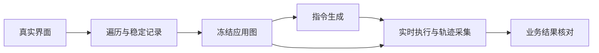

# ReGROW 设计思路：先读这页

更新：2026-11-04。此页组织现有设计意图、字段入口、环节职责及待实施方案，不新增字段或修改Prompt。源码基线固定到[14a6f1a7](https://github.com/melonthrower/regrow/tree/14a6f1a717bf6de3693630a0b9d68bb30c7dd2db)，本批源码不变；实现位置见独立的[流程与代码地图](modules/stepwise/CODE_MAP.md)。

## 我们要解决什么

先探索应用，收集功能、参数、必要条件和实际访问认识；图冻结后围绕有意义的业务目标生成指令，再由执行Agent依据实时界面采集真实轨迹。导航和打开未知内容是重要探索工作，但不是把所有导航动作原样包装成用户任务。图的意义最终要通过生成任务和实机结果检验，不能用节点数或已登记动作数替代。

遍历、生成、采集是整体方法的三个阶段；recognition/traversal/records是遍历代码内部的职责划分，二者不是同一套“三部分”。生成与采集只读冻结图，不反向改遍历框架、原图或活动运行。

## 从哪个概念进入

完整定义和逐字段动机保留在[对象字段说明](modules/stepwise/object_fields.md)，不另立第二套术语表。此表只说明各概念在整体设计中的作用和阅读去向。

|概念|为什么需要它|详细入口|
|---|---|---|
|Region|把相关对象的用法、条件与局部探索组织成可复用单元；不要求单一功能或必须有控件|[区块与知识](modules/stepwise/object_fields.md#区块)|
|Control|保留具体交互对象的稳定身份，不因同名、同图标或共同用法合并|[控件与共享引用](modules/stepwise/object_fields.md#控件)|
|knowledge / local_knowledge|让已知认识进入对象，供后续任务复用，不再另存一套任务答案|[字段设计动机](modules/stepwise/object_fields.md#字段的设计动机与责任2026-11-04)|
|constraints / conditions|保留使用所需候选、规则与适用条件，避免只记样本值；同名字段分层解释|[知识、参数与功能引用](modules/stepwise/object_fields.md#同名字段不能跨层理解)|
|Task / inventory|Task推动具体未知，inventory说明给定范围是否考虑过；不再造第二份问题清单|[任务及当前完成实现](modules/stepwise/object_fields.md#任务)|
|Action / result / evidence|将计划、真实投递、观察、登记和业务结论分开，保留可追溯来源|[动作](modules/stepwise/object_fields.md#动作)|
|functions|将对象知识整理成可复用业务目的及支撑/参数引用；不是生成指令的唯一输入|[区块功能目录](modules/stepwise/object_fields.md#区块知识与功能目录)|
|访问关系 / jump_to|记录如何通过实际操作到达区块或控件，不把同屏共现和物理包含当导航|[访问关系](modules/stepwise/object_fields.md#访问关系更新)|
|前景与状态观察|让当前可操作场景、历史身份和原问题归属分开，避免把旧图当当前事实|[字段动机](modules/stepwise/object_fields.md#字段的设计动机与责任2026-11-04)|
|instruction / setup / collection|把探索问题转换为业务目标，准备必要初态，再用实时观察验证与采集|[生成与采集字段及环节](modules/visual_collection.md)|

Luna负责界面语义、未知与进展判断；框架负责供给相关身份/历史、解析和保存稳定引用、调度与真实执行记录；Prompt只传达本次问题和允许输出，不代替尚未确定的系统设计。预算在框架计数，不作为剩余额度写入Prompt。

## 三种“树”不要混在一起

|结构|当前用途|这次讨论的边界|
|---|---|---|
|Region.parent_region及当次parent/parent_index|当前代码仍保存物理包含关系|拟取消该持久层级；尚未实施，不等于删除Region或其控件/任务|
|当前界面组合视图page_context|读当前观察和包含关系组织本次界面材料|它会受到退役父级的影响，不能只删一个字段不改读取|
|控件树与功能树environment_context|同一对象/访问图的两种阅读投影|下级表示相关操作可到达的目标，不是物理子区块；无需整体拉平|

总窗口天然包含许多功能区，不应仅为容器而自动产生重复探索职责；现有粗细分区需要依据知识/任务归属核对，不能直接删除已有记录。共享控件的本次呈现关系也不能被“全局唯一owner”代替。这些是本次讨论的设计方向和问题，不表示源码已完成重分区。

## 怎样判断探索是否值得继续

以是否增加可复用的功能、参数、操作方式或条件知识衡量，而非按项目个数决定次数。独立功能入口不能仅凭外形相似合并；同质实例可以复用共同用法；参数候选应作为参数材料收集，发现新的条件差异再调查。完整候选收集和上下文按需读取尚未全部落地，当前代表项Prompt中仍有未确认草稿。

目标约定是：已进行任务提出，且给定范围的有效任务解决，才称本区块探索完成；离开区块不等于完成，暂挂保留并继续其他工作。代码实际coverage还检查inventory、考虑过的控件及登记缺口，不能把目标约定直接写成“实现已经只看tasks”。不同层次的完成也分开：动作登记、任务回答、区块探索、全应用覆盖和最终业务成功不能互相替代。

## 哪些已实现，哪些仍只是方案

|层次|目前能说什么|
|---|---|
|设计约定|稳定对象与共享引用、原问题归属、知识归对象、真实动作证据、图只读指导后续收集，详见相应对象/模块文档|
|代码实际存在|相关builder、记录、调度、两树与生成采集入口已接线；存在不等于所有语义都正确|
|已有有限证据|[Impress/Calc旧调用案例](../issue_cases/20261104-regions-and-actions/README.md)可核对具体成功、错误和中断；不能据此认证所有应用或新设计|
|仍待确认或实施|父子关系退役、共享控件纠错/点位核对候选、完整候选收集与相关上下文组织；五份Prompt草稿状态见[已知问题](../KNOWN_ISSUES.md)|

当前全局观察允许登记控件、局部辨认与任务提出仍通常分调用；不能把曾讨论的优化当作现有pipeline。前景不应是许可名单的设计约定与代码仍有interactive_regions限制也须分开。研究旧文中的Variant/层级目标属于对应版本，不自动代表当前src/regrow有同名独立实体。

## 待实施方案

- [区块父子关系退役：设计、改动表与完整Prompt候选](proposals/region-parent-removal-20261103/README.md)。这是此前已展示的候选副本，不是本轮新改Prompt；包含方向与字段退出的具体接线，实施前仍须确认候选。
- [动作点位核对与共享控件纠错：设计与改动表](proposals/action-and-correction-20261103/README.md)。两项责任分别处理，取消父子边不能冒充它们已修。

方案各自固定其原源码基线；不能混成当前已验收规范。真正实施时应重新对齐需要改变的字段含义、实际调用合同和验收案例。

## 阅读顺序

1. 本页看整体目的与关系。
2. [对象字段](modules/stepwise/object_fields.md)看每组字段的动机、边界、判断和保存；[生成采集字段](modules/visual_collection.md)看下游合同。
3. [流程与源码地图](modules/stepwise/CODE_MAP.md)看每一步的问题、17类遍历调用、原生入口和实现锚点。
4. [已知问题](../KNOWN_ISSUES.md)和[真实案例](../issue_cases/20261104-regions-and-actions/README.md)核对设计与实际差距。
5. [研究目标](RESEARCH_GOAL.md)和[历史设计对齐](REGION_TRAVERSAL_ALIGNMENT.md)看方法链与背景；带日期旧说明不覆盖当前schema、源码事实或候选状态。

本批只整理并公开设计说明，未修改框架、Prompt、schema、旧图或运行；文本、链接和源码锚点检查不是新增模型/GUI验收。
