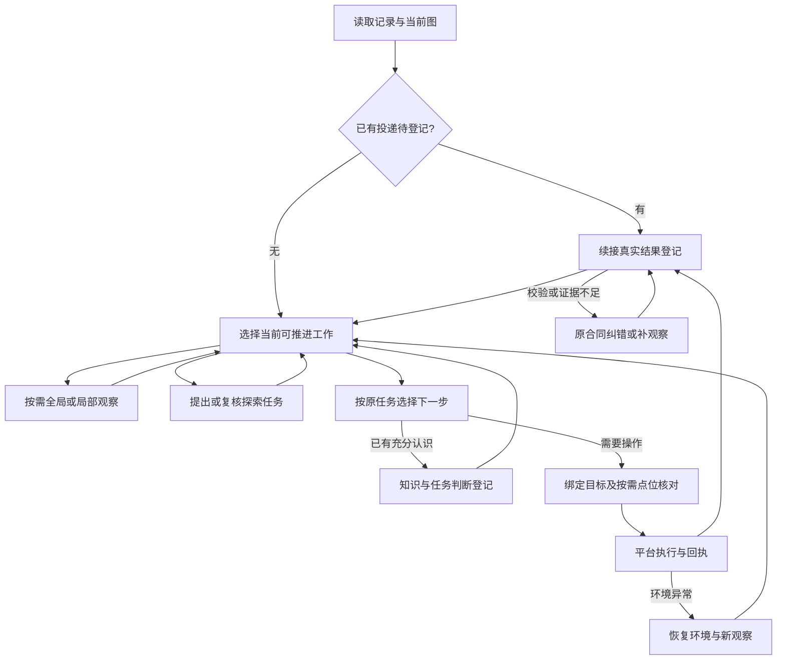

# 当前流程设计与源码地图

调用表更新：2026-11-07，独立control_identity_selection、function_registration和task_result_review已退出，当前共13类活动调用。下方源码锚点仍固定到2026-11-04导出的 [14a6f1a7](https://github.com/melonthrower/regrow/tree/14a6f1a717bf6de3693630a0b9d68bb30c7dd2db)，用于历史导航；最新冻结后修订的当前行锚见[具体改动图](../../proposals/postfreeze-handoff-20261106/CHANGE_MAP.md)，旧Control改动另见对应批次地图。以下不是全框架行为验收。

## 正常推进与异常分支

图表示可能分支，不是每轮都走完的固定模型流水线。已投递动作优先续登记是实际执行约束；全局/局部观察均为observation，只是范围与材料不同。当前全局格式允许控件，局部格式聚焦一个Region；“全局仅识别区块、局部顺带提出任务”仍不能当作已完成改造。局部辨认登记对象/已有知识，任务提出通常是独立task_proposal；允许的调用也可增量写function_updates。功能增量由正常task_proposal/observation_update写入；不再有独立function_registration入口。

## 为什么保留这些调用边界

|调用键|何时需要、主要问题|主要输出及边界|
|---|---|---|
|observation|当前结构或目标位置需要辨认；全局与局部共享角色|区块/控件身份、观察和允许的知识增量，不保证全页一次看完|
|task_proposal|需要考虑当前范围或复核原问题|new_tasks、已有任务判断及允许的对象知识；shared_instances与三态inventory已退出；保留任务提出来源和明确review|
|action_selection|已有问题可推进，或需导航/准备|真实动作与参数，或已有答案/暂挂；准备不换原问题|
|observation_update|实际操作后有结果要核对|实际来源下的观察、知识、访问关系和任务进展；不是按原目标虚构动作效果|
|action_target_review|动作身份或点位存在具体疑点|沿原动作schema确认/修正，不另造decision协议；外观裁剪不是点击范围|
|control_identity_comparison|候选与现图身份关系需要进一步核实|同一/不同等有据判断，不把缺少匹配当对象不存在|
|ownership_review|实际观察的对象归属存在争议|核对本次区块/控件关系，不把知识修订强行变成全局唯一owner|
|object_registration|当前对象缺少足够的定位材料|补给定候选的必要几何，不能借此缩掉真实访问目标|
|appearance_comparison|旧外观与当前图的状态关系需要比较|比较原图并说明条件，再决定是否追加外观；不凭小裁剪推断完整业务状态|
|step_observation|结果解释存在具体观察问题|围绕原问题补evidence，不重新执行已投递动作|
|step_correction|最新回复校验失败|沿实际已发合同纠正；新源码格式不覆盖旧请求|
|branch_correction|原分支暂不可推进，需要处理挂起/切换|保留原问题及实际障碍，不把离开区块当完成|
|recovery|应用退出、外部界面或环境异常|恢复当前工作环境与观察，随后重新判断原问题；不是业务成功证明|

这13个键来自[调用组成](../../../src/regrow/prompts/流程/调用组成.json)。不是13次固定调用；包装纠错可能复用外层role，判读真实记录时同时看role、stage、实际schema与提示。实际格式由builder及条件扩展决定，静态schema和表中概括不替代发送合同。

目标应用材料当前进入observation、task_proposal、action_selection、observation_update和recovery，action_target_review沿原动作合同承接。历史清点及已发纠错保留原合同，不要求全部13类调用都新增external_app输出。异常可以在动作前发现，并非只有动作后才检测；图未画出每个调用到恢复的所有分支。

## 当前实现锚点

|环节|唯一负责实现与源码锚点|设计解释/现状边界|
|---|---|---|
|遍历总入口|[_run_step](https://github.com/melonthrower/regrow/blob/14a6f1a717bf6de3693630a0b9d68bb30c7dd2db/src/regrow/traversal/run_task_step.py#L51-L241)|优先续已投递动作登记；再按当前工作分支推进。|
|工作选择|[select_work](https://github.com/melonthrower/regrow/blob/14a6f1a717bf6de3693630a0b9d68bb30c7dd2db/src/regrow/traversal/traversal_scheduler.py#L111-L201)|按原任务、当前表面和可推进工作选择，不等于每轮调用所有角色。|
|发现请求|[prepare](https://github.com/melonthrower/regrow/blob/14a6f1a717bf6de3693630a0b9d68bb30c7dd2db/src/regrow/recognition/locator.py#L54-L171)|全局/局部两种观察范围共用observation调用。|
|发现格式|[schema](https://github.com/melonthrower/regrow/blob/14a6f1a717bf6de3693630a0b9d68bb30c7dd2db/src/regrow/recognition/locator.py#L12-L37)|局部限制一个Region；当前全局格式也允许控件，并非已实现“全局只报区块”。|
|发现入账|[commit](https://github.com/melonthrower/regrow/blob/14a6f1a717bf6de3693630a0b9d68bb30c7dd2db/src/regrow/traversal/discovery_step.py#L51-L305)|身份与观察通过后发布，拒绝项保留纠错/补登记。|
|任务提出|[TaskProposer.request](../../../src/regrow/traversal/task_proposer.py#L62)|给出当前未知及既有认识；不是要求每个控件都建任务。|
|任务计划登记|[apply_plan](https://github.com/melonthrower/regrow/blob/14a6f1a717bf6de3693630a0b9d68bb30c7dd2db/src/regrow/traversal/region_tasks.py#L14-L124)|保存新增任务、已有问题判断和本轮清点；对象知识保持对象归属。|
|动作请求|[request_from_run](https://github.com/melonthrower/regrow/blob/14a6f1a717bf6de3693630a0b9d68bb30c7dd2db/src/regrow/traversal/action_proposer.py#L61-L162)|绑定原探索问题，读取当前图、历史和实际可用schema。|
|目标绑定|[bind_action_target](https://github.com/melonthrower/regrow/blob/14a6f1a717bf6de3693630a0b9d68bb30c7dd2db/src/regrow/traversal/action_binding.py#L3-L8)|把本次选择解析到稳定对象；绑定成功不是位置或效果正确。|
|点位疑点|[conflict](https://github.com/melonthrower/regrow/blob/14a6f1a717bf6de3693630a0b9d68bb30c7dd2db/src/regrow/recognition/action_target_review.py#L89-L112)|有疑点才交模型核对；空候选位置仍有已知漏放行。|
|真实投递|[ActionExecutor.execute](https://github.com/melonthrower/regrow/blob/14a6f1a717bf6de3693630a0b9d68bb30c7dd2db/src/regrow/runtime/action_executor.py#L44-L131)|投递前检查与平台执行，保留真实回执，不自行证明业务成功。|
|动作后请求|[build_attempt_update](https://github.com/melonthrower/regrow/blob/14a6f1a717bf6de3693630a0b9d68bb30c7dd2db/src/regrow/traversal/result_updater.py#L130-L233)|按真实来源、动作前后图构造更新，不以原任务控件替换实际来源。|
|动作后登记|[commit_update](https://github.com/melonthrower/regrow/blob/14a6f1a717bf6de3693630a0b9d68bb30c7dd2db/src/regrow/traversal/register_update.py#L61-L281)|接受知识、观察、关系和任务判断；失败不重放已执行GUI。|
|区块完成实现|[coverage](../../../src/regrow/records/tasks.py#L430)|新调用用任务提出来源、明确复核、新观察对象与pending/blocked；旧三态不决定完成，首次提出前也不因空Task完成。|
|任务判断登记|[decide](https://github.com/melonthrower/regrow/blob/14a6f1a717bf6de3693630a0b9d68bb30c7dd2db/src/regrow/records/task_updates.py#L97-L139)|模型判断仍受真实阻塞和已有证据约束。|
|稳定对象与共享引用|[Records](https://github.com/melonthrower/regrow/blob/14a6f1a717bf6de3693630a0b9d68bb30c7dd2db/src/regrow/records/object_store.py#L222-L347)|全局控件记录与Region成员引用；不是每个Region复制一份控件。|
|事务发布|[publish](https://github.com/melonthrower/regrow/blob/14a6f1a717bf6de3693630a0b9d68bb30c7dd2db/src/regrow/records/snapshots.py#L71-L94)|单一入口发布正常、纠错和恢复的记录增量。|
|引用呈现/解析|[prepare](https://github.com/melonthrower/regrow/blob/14a6f1a717bf6de3693630a0b9d68bb30c7dd2db/src/regrow/recognition/named_references.py#L183-L260)|按本次合同建立可读引用，不要求所有角色都采用同一种外部写法。|
|原合同纠错|[call](https://github.com/melonthrower/regrow/blob/14a6f1a717bf6de3693630a0b9d68bb30c7dd2db/src/regrow/runtime/reply_correction.py#L62-L129)|解析/schema重答沿真实原请求与原额度，不切换新语义。|
|业务修复协调|[Runner.perform](https://github.com/melonthrower/regrow/blob/14a6f1a717bf6de3693630a0b9d68bb30c7dd2db/src/regrow/traversal/step_repair.py#L441-L831)|处理最新业务拒绝、观察与续接，不能靠手改回复宣布成功。|
|独立功能整理|[request](https://github.com/melonthrower/regrow/blob/14a6f1a717bf6de3693630a0b9d68bb30c7dd2db/src/regrow/traversal/region_functions.py#L117-L133)|整理已有对象知识；入口存在不等于普通调度每区块必调用一次。|
|两棵阅读树|[forest](https://github.com/melonthrower/regrow/blob/14a6f1a717bf6de3693630a0b9d68bb30c7dd2db/src/regrow/records/environment_context.py#L63-L150)|从对象和访问关系投影控件/应用操作目录，不持久保存另一棵包含树。|
|当前页面组合|[build](https://github.com/melonthrower/regrow/blob/14a6f1a717bf6de3693630a0b9d68bb30c7dd2db/src/regrow/records/page_context.py#L90-L176)|当前代码仍读取parent_region组织观察视图，尚未退出物理层级。|
|应用异常|[accept](https://github.com/melonthrower/regrow/blob/14a6f1a717bf6de3693630a0b9d68bb30c7dd2db/src/regrow/traversal/application_judgement.py#L49-L76)|先交接异常，再恢复；不继续登记外部业务或投递普通动作。|
|恢复循环|[run](https://github.com/melonthrower/regrow/blob/14a6f1a717bf6de3693630a0b9d68bb30c7dd2db/src/regrow/traversal/recover_loop.py#L26-L238)|先恢复环境和观察，随后回到原问题。|
|恢复任务续接|[resume](https://github.com/melonthrower/regrow/blob/14a6f1a717bf6de3693630a0b9d68bb30c7dd2db/src/regrow/traversal/recovery_tasks.py#L45-L106)|恢复前景不等于业务问题完成；准备条件仍需重新核实。|
|三阶段共享图读取|[load_collection_graph](https://github.com/melonthrower/regrow/blob/14a6f1a717bf6de3693630a0b9d68bb30c7dd2db/gui_rewalk/src/core/scenario/collection_graph.py#L124-L148)|冻结数据只读加载；读取实现仍依赖src/regrow，不能只复制gui_rewalk。|
|生成材料选择|[generation_material](https://github.com/melonthrower/regrow/blob/14a6f1a717bf6de3693630a0b9d68bb30c7dd2db/gui_rewalk/src/core/scenario/collection_graph.py#L73-L105)|提供功能、控件用法、参数和条件；不以functions非空作为唯一材料来源。|
|指令设计|[design_region_instruction](https://github.com/melonthrower/regrow/blob/14a6f1a717bf6de3693630a0b9d68bb30c7dd2db/gui_rewalk/src/core/scenario/function_collection_research.py#L67-L95)|围绕业务目标组合已有材料并校验引用；不证明实机可执行。|
|初态准备|[prepare_collection_seed](https://github.com/melonthrower/regrow/blob/14a6f1a717bf6de3693630a0b9d68bb30c7dd2db/gui_rewalk/src/core/scenario/collection_seed.py#L80-L160)|生成/投放素材、打开并观察初态；不提前完成目标修改。|
|采集执行|[RegionGuidedCollector.execute](https://github.com/melonthrower/regrow/blob/14a6f1a717bf6de3693630a0b9d68bb30c7dd2db/gui_rewalk/src/core/scenario/function_collection_research.py#L127-L315)|结合实时截图执行目标、条件分支和终验，图是指导而非固定脚本。|
|采集点位核对|[CollectionVisualGuard.check](https://github.com/melonthrower/regrow/blob/14a6f1a717bf6de3693630a0b9d68bb30c7dd2db/gui_rewalk/src/core/scenario/collection_visual_guard.py#L31-L84)|区分身份外观与点击范围；匹配不足按现有模型确认路径处理。|

## 这批文档与方案的关系

[设计导读](../../DESIGN_INTENT.md)说明跨阶段目的；[对象字段](object_fields.md)保存字段解释和动机；[生成/采集](../visual_collection.md)说明下游字段。两份[待实施方案](../../DESIGN_INTENT.md#待实施方案)分别处理父子关系与动作/共享纠错，不能把代码定位表当作这些改动已经实现。

本批编辑只有设计导读、字段动机、流程定位、生成采集说明、阅读链接及既有候选副本；不改src/gui_rewalk/tools/ops或运行图。验收只检查文字一致性、源码锚点、相对链接、候选身份和无凭据，不新增Luna/GUI验证。实际失败过程见[历史案例](../../../issue_cases/20261104-regions-and-actions/README.md)。
