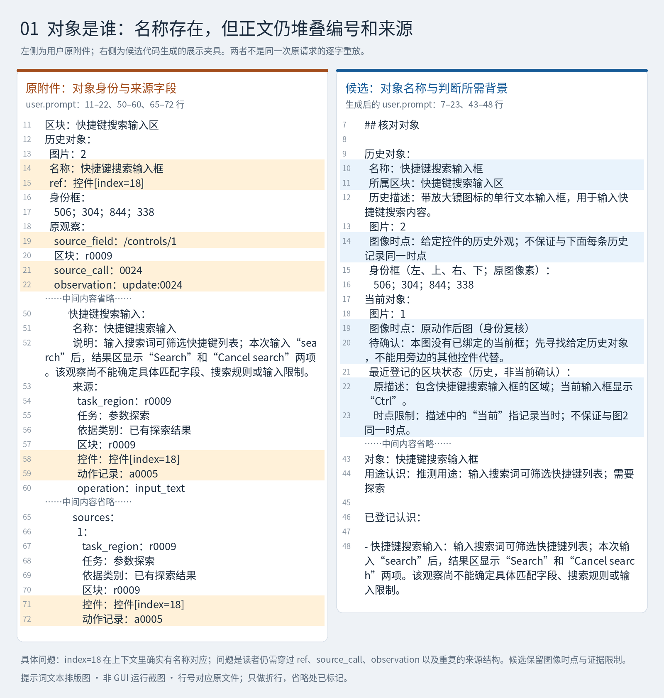
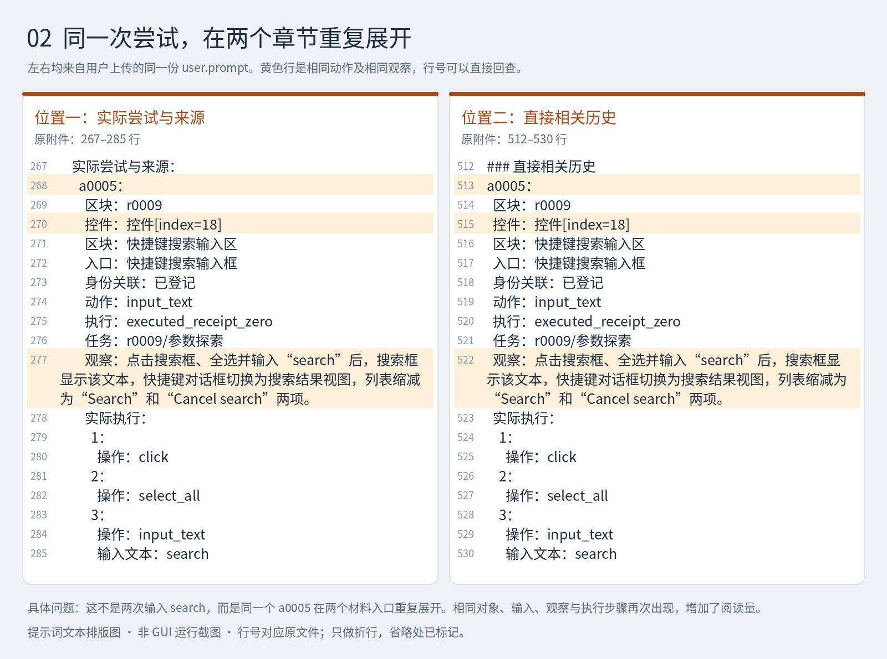
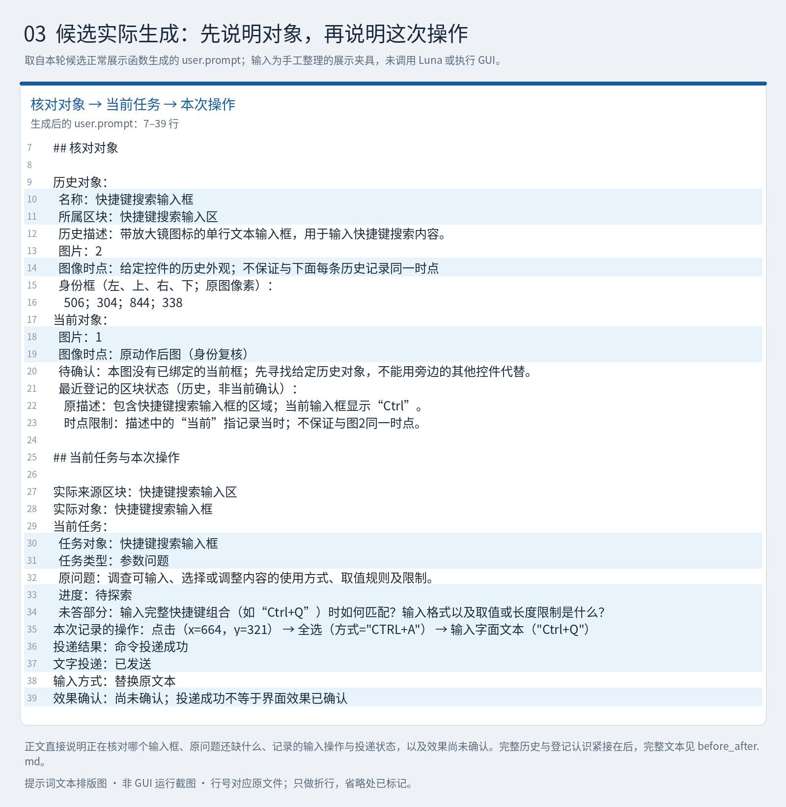

# 身份提示词披露：问题与候选对照图

代码候选：[cfbfd30](https://github.com/melonthrower/regrow/commit/cfbfd305b54117ecbea04cb125d157dd34c89fc2)，基于 `e22481b`。这是用户授权上传的未完成研究检查点，尚未做真实 Luna/GUI 行为验收。

以下是**提示词文本排版图，不是 GUI 运行截图**。原文选段来自用户上传的 `user.prompt`；候选选段是正常展示函数以手工夹具为输入生成的 `user.prompt`。原附件与候选夹具不是同一原始请求的逐字重放。图中行号用于回查来源，不是建议放入 Luna 的提示词。

## 1. 控件 18 有名称，但仍被编号和来源结构包围

原附件已经把 `控件[index=18]` 对应到“快捷键搜索输入框”。具体问题是正文同时展开内部引用、调用编号、观察编号及重复的来源结构。候选以名称、所属区块和判断需要的时点限制说明对象。

## 2. 同一次动作在两个位置重复展开

原附件的“实际尝试与来源”和“直接相关历史”再次展示同一个 `a0005` 的对象、输入、观察和步骤。下图直接展示这一重复现象；候选的合并机制见 [prompt_material.py](https://github.com/melonthrower/regrow/blob/cfbfd305b54117ecbea04cb125d157dd34c89fc2/src/regrow/prompts/prompt_material.py)，不能由这张图推断模型行为已经改善。

## 3. 候选先说明对象、任务和本次操作

生成文本直接说明核对对象、未答问题、记录的输入操作、投递状态，以及效果尚未确认。字面文本 `Ctrl+Q` 不表示执行该快捷键。原始结构仍保留内部身份与证据；这些字段不必原样展示给模型。

图中提到的 `before_after.md` 是本次对话此前交付的完整前后对照附件，不在这个仓库目录中；本页展示的是其中的选段。

## 验证与缺口

沿用代码候选的聚焦检查：70 通过、13 失败；27 个新增检查通过，原有 56 项与基线均为 43 通过、相同 13 项失败。图片及文档经过原文核对和独立读者复核。本次配图未改变代码、提示或测试，未新增 Luna 或 GUI 调用。详见 [当日日志](../../../devlog/2026-10-20.md)。

这次没有取得对应运行的真实应用截图、原始请求和运行快照，因此不能据此确认 Shortcuts / Search Results 的视觉身份，也不能宣称改动已通过原生行为验收。
