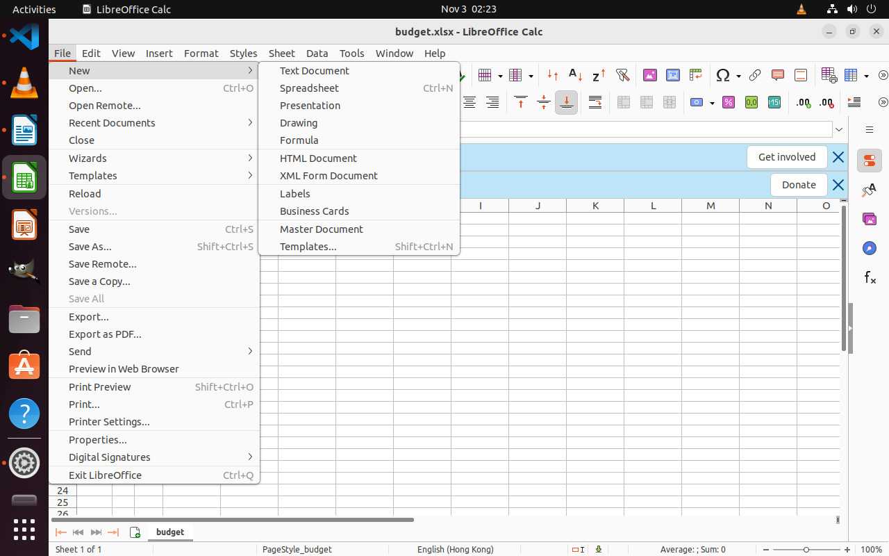

# Calc：区块包含与访问关系

[逐次调用0131–0142](CALLS.md) · [0142时应用树](trees/README.md) · [原生动作记录](actions.json)

旧图登记r0021文件命令菜单的父区块为r0013菜单栏，r0022 New子菜单的父区块为r0021。与此同时，控件c0039文件菜单、c0079 New已经各自保存实际访问关系。

a0018真实点击New，动作后图显示右侧新建目标菜单。0142是该结果的纠错回复，完整候选合并后沿原框架登记。这里只确认菜单及选项出现，没有在这一步选择新建目标或验证新文档内容。

这说明“位于哪个容器”和“通过哪个控件访问”应分别理解。拟取消的是持久父子包含关系；已有控件身份、功能知识和有真实证据的访问关系仍应保留。控件探索树与功能树可以继续按访问关系展开，不应整体拉平。

树为0142当时已接受的图，不混入之后0368等快照才有的功能。没有登记功能的区块保留为空目录；这不表示该区块没有功能，也不构成应用已充分探索的证明。本例没有删除或重组原图。
