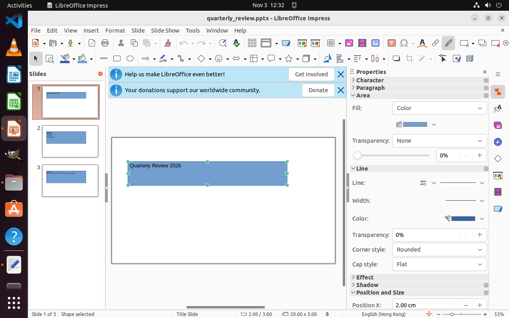
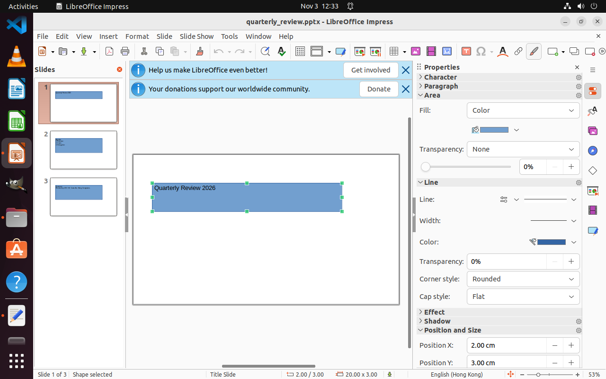
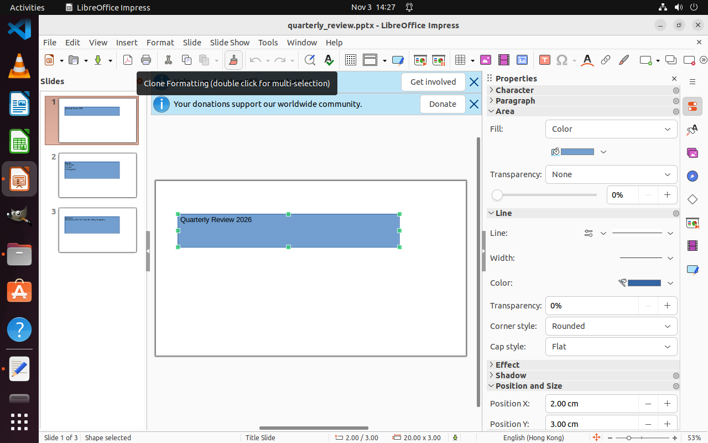
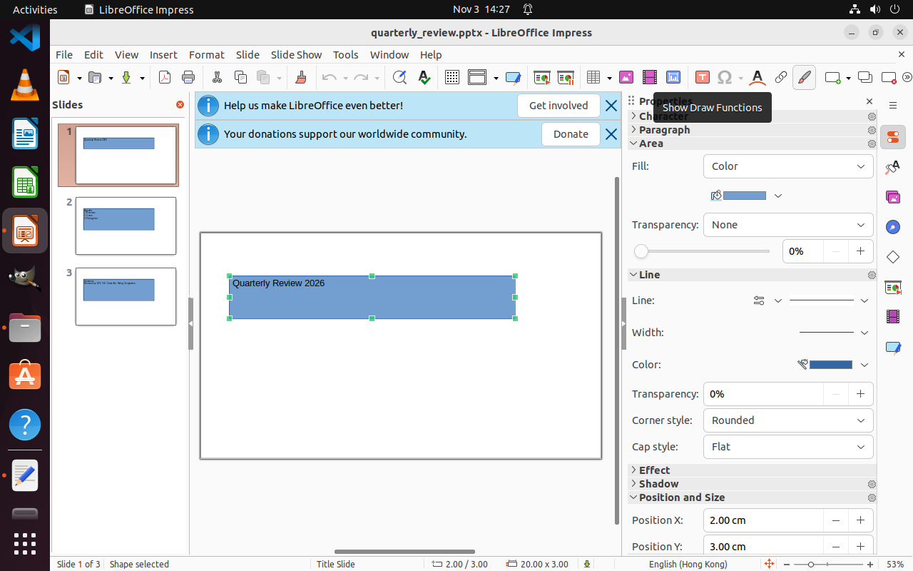

# Impress：分区、点位与共享控件纠错

[逐次调用0074–0107](CALLS.md) · [当时应用树](trees/README.md) · [原生动作记录](actions.json)

旧图将r0007菜单栏、r0009画布、r0011标准工具栏等挂到r0006总窗口；c0062格式刷同时被总窗口和标准工具栏引用。这里既有粗细分区混杂，也有合法的共享控件身份，不能用删除一个“归属”来掩盖纠错问题。

## 实际点位与图中身份不符

0090、0093、0106均返回格式刷目标，却给出右侧约(1127,108)的点位。对应a0008/a0009/a0013回执exit_code为0，前两次已登记，a0013未登记；回执semantic_result仍为unverified。a0013前后图显示第二排绘图工具栏消失，不能把它解释成格式刷使用成功。

以下为2026-11-03后来单独执行的悬停诊断旧图，不是上述点击当时的截图：左侧画刷提示Clone Formatting，右侧实际点击处提示Show Draw Functions。诊断只悬停，没有点击文档。

旧门禁复核在拟点击点没有其他可靠候选时返回None，即使原目标在另一处有可靠当前定位。见existing-gate-diagnosis.json。此文件是旧实现的辅助诊断，不是新核对行为验收。

## 0107之后的本地纠错中断

0107的HTTP为200且有完整模型回复；由于后续建议目标等登记问题进入纠错。准备下一份纠错请求时，named_references的呈现代码要求为知识修订c0062找到唯一Region，遇到r0006/r0011共享引用而抛出“无法确定知识修订控件的所属区块”。新的纠错HTTP尚未发出。见[原有停止堆栈](framework-stop.txt)及repair-history.json。

0107回复还把绘图栏前后都说成可见，该回复没有接受入图。应用树取0105已接受快照，保留此前已错误登记的格式刷来源关系，不能直接拿它生成可靠执行路线。取消Region父子边不会自动修复共享控件纠错，也不会自动修复点位核对。本例没有实施修复。

该快照有8个Region，但没有已登记的functions条目；功能树原样显示空目录，不是漏导出，也不表示控件用途知识全部为空。后续悬停的原生回执在diagnostic/left和diagnostic/right。
