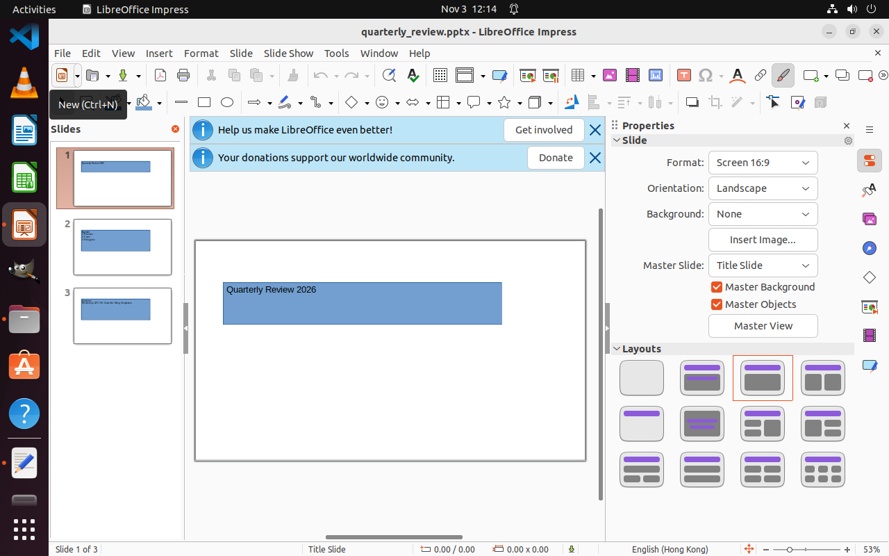

# LibreOffice Impress 调用 0076

类型：原步骤纠错（`step_correction`）；阶段 `step_correction`。HTTP状态：200；响应文件：存在。

本页不凭响应存在推断是否登记或操作成功。

[完整请求（脱敏副本）](request.json) · [系统提示](system.prompt) · [动态上下文](user.prompt) · [实际回答格式](response.schema.json) · [实际回复（脱敏副本）](response.json) · [原始响应封装](raw_response.json)

原请求中的截图路径保持原引用；下面文件按原输入顺序复制，映射见 images.json。原图未编辑。

