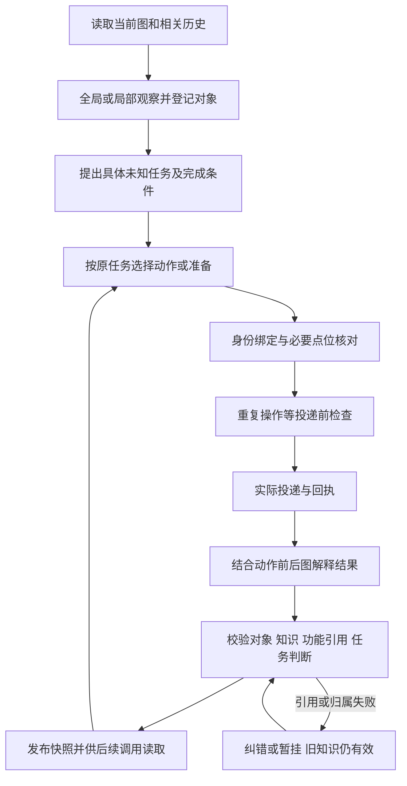
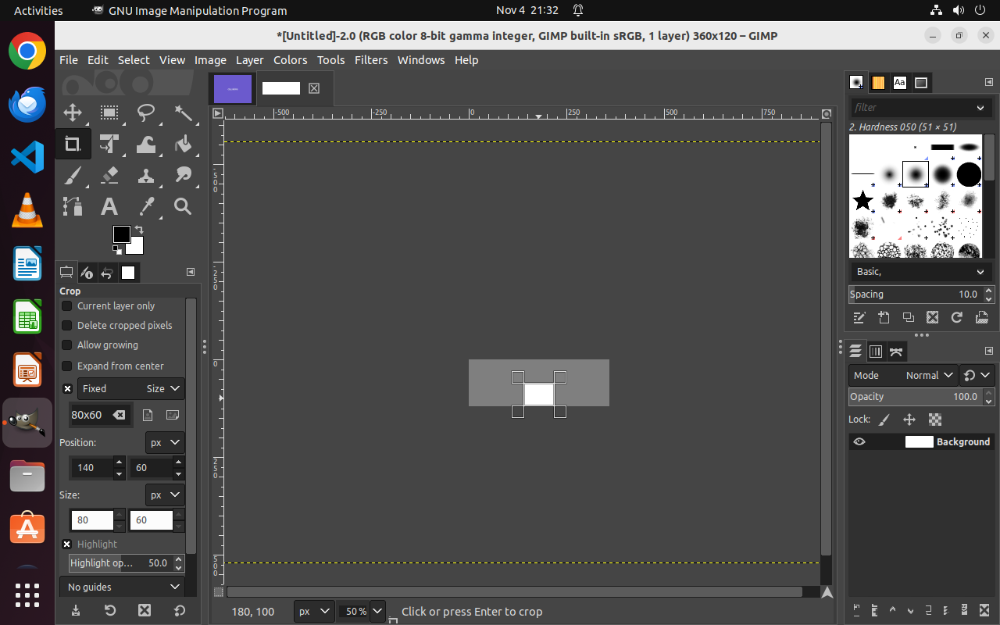
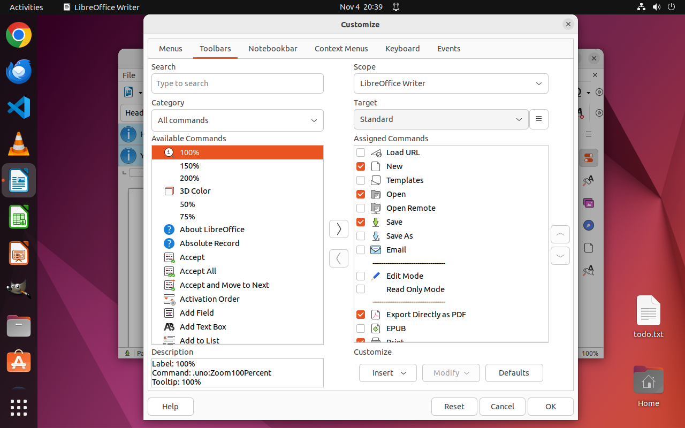
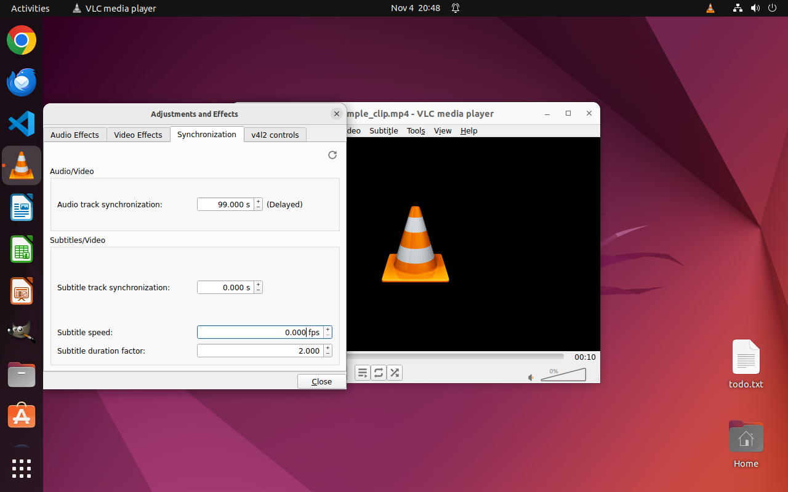
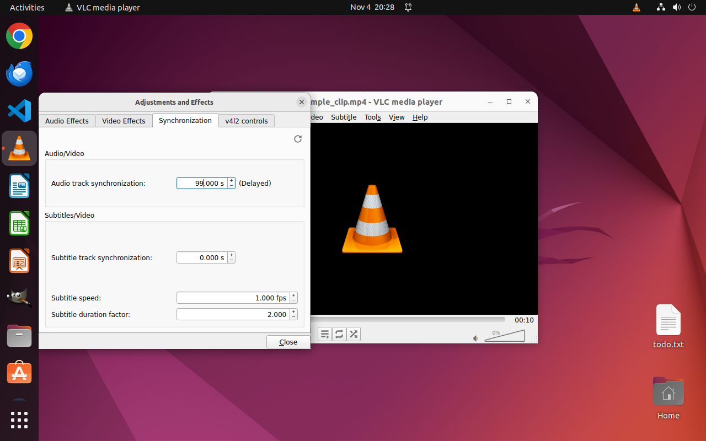
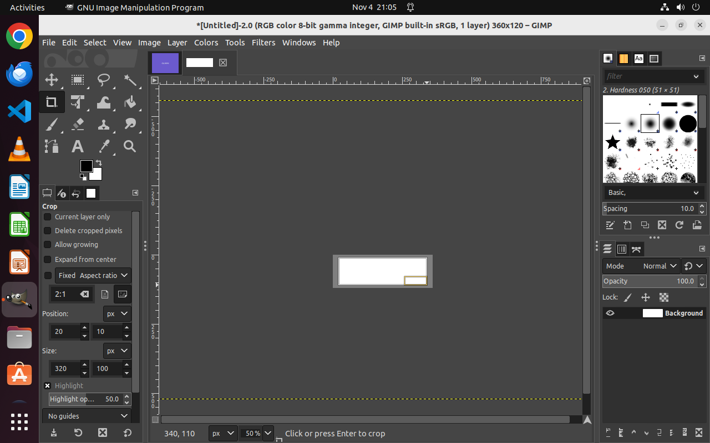
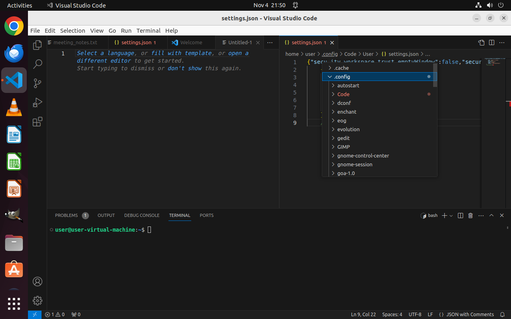
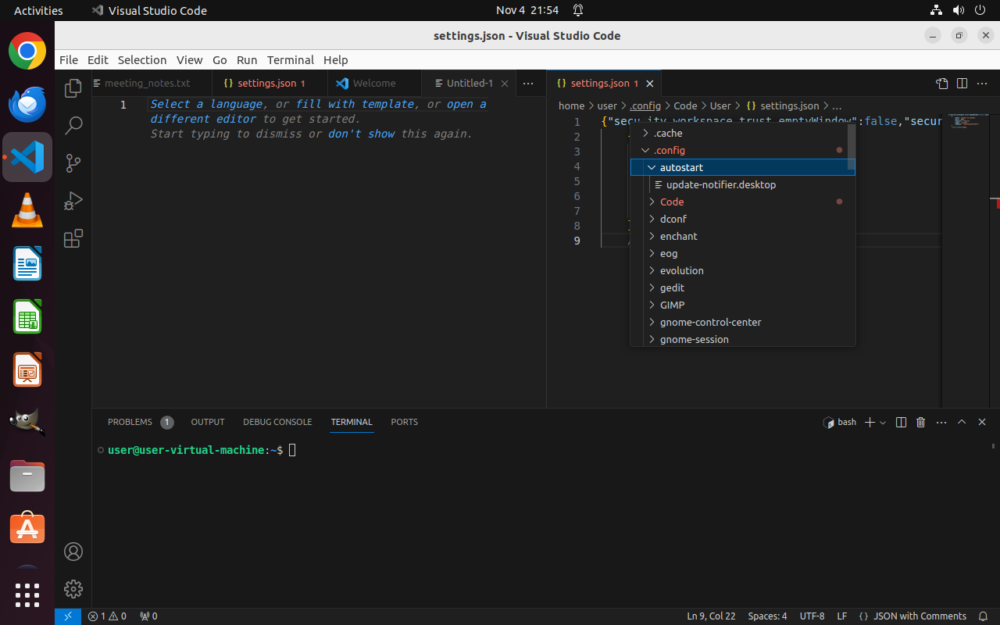
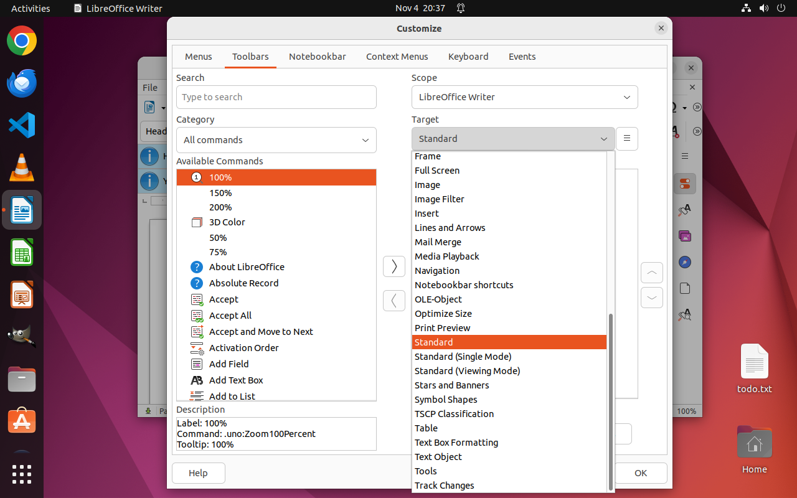
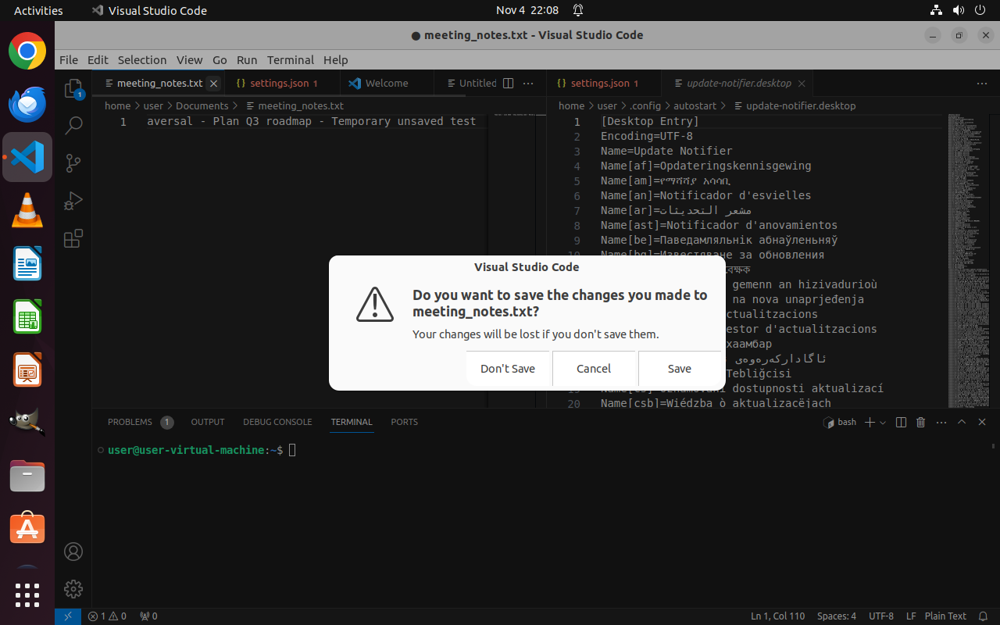

# ReGROW遍历：设计问题，还是接线问题？

这是给网页版Astra的**问题讨论材料**，不是修复发布。仅公开用户指定的真实案例、截图、相关调用/图快照和局部冻结源码；原始运行保持不变。版本边界见[VERSION](VERSION.json)。运行源是approved-source-v8加两份尚未整体验收的实验修补，不能当作仓库根源码同一版本。

证据与局部运行源码固定到提交[a203bf28](https://github.com/melonthrower/regrow/tree/a203bf289d4cd0c6a7c3ee653aa9510df5e812e7/issue_cases/20261104-traversal-design-and-wiring)。

先读[设计讨论](DESIGN_DISCUSSION.md)，再看[代码位置及拟议改动表](CHANGE_MAP.md)和[实际调用类型/流程索引](CALL_INDEX.md)。整体方法/概念沿用仓库现有[设计导读](../../design/DESIGN_INTENT.md)，不另造术语表。

## 正常流程与本轮卡点

这是现有可能调用链的概览，不是每轮固定调用次数。全局/局部观察和任务提出的分界仍以真实请求为准。能投递、模型说answered、快照已发布和原问题已解决是四件事。

## 1. 真实结果未能登记：GIMP，及共享控件崩溃

**过程：**0336在Fixed/Size、80x60条件下拖动画布；a0126后图读数80×60。0337报告answered并补知识；0338要求修复跨区块支持引用；0339又要求修复功能引用。纠错耗尽后，当前Size任务仍blocked/result_registration_pending，知识仍是初选0x0、尚未验证非零尺寸。0340随后只拿到旧知识及静态画面。

[0337完整请求](evidence/gimp/calls/0337/request.json) · [原答](evidence/gimp/calls/0337/response.json) · [0338纠错要求](evidence/gimp/calls/0338/user.prompt) · [0339纠错要求](evidence/gimp/calls/0339/user.prompt) · [当前任务](graphs/gimp/tasks.json) · [当前知识](graphs/gimp/objects.json)。

**另一种接线失败：**Writer a0042操作Target下拉框，只给Assigned Commands列表补知识；该列表被两个Region引用。纠错呈现找不到唯一展示归属而抛异常。实际动作来源与被修订控件不同，已有A1来源补丁没有覆盖这个分支。[原异常](evidence/libreoffice-writer/correction-exception.txt)、[0181原答](evidence/libreoffice-writer/calls/0181/response.json)、[0183补定位原答](evidence/libreoffice-writer/calls/0183/response.json)。

**判断边界：**共享控件呈现崩溃是具体合同/接线问题；功能引用失败阻断整个结果发布也暴露事务责任边界，如何调整需设计讨论。本例只证明该设定下单次尺寸约束，不证明所有尺寸、一般解析机制或已应用裁剪。

## 2. 正常恢复被重复防护拦下：VLC

**过程：**0252确认输入0.000后可见该值；0253想恢复原1.000。0254请求明确以a0071/a0073同入口参数为由禁止原样再试；Luna遂返回none，本次恢复未投递。后来0257操作另一字段时看到速度回1.000，原因未确认，不能记成本次恢复成功。

[0253拟恢复原答](evidence/vlc/calls/0253/response.json) · [0254实际纠错要求](evidence/vlc/calls/0254/user.prompt) · [0254原答none](evidence/vlc/calls/0254/response.json)。

**判断边界：**恢复动作被拦是已证实行为；不能只靠将阈值放大解决。需要讨论“任务仍pending、入口/参数相同”是否足以断言没有知识进展，怎样复用已有状态/过程证据区分有效恢复与空转。也不能把该请求当成已经执行失败的GUI。

## 3. 投递事实被知识文字改写：VLC

**过程：**0206/a0065的dispatch.action.text为9999，回执记录text_delivered；0207却将本次输入写成999，并写入c0117知识。截图显示99.000 s（原答记作99,000 s），不能倒推出实际投递的字符，更不能证明9999已被控件接受或解释其数值范围。

[真实投递](evidence/vlc/action_attempts/a0065/dispatch.json) · [回执](evidence/vlc/action_attempts/a0065/receipt.json) · [0207原答](evidence/vlc/calls/0207/response.json) · [当前c0117知识](graphs/vlc/objects.json)。

**判断边界：**已发生事实错误；0207正常请求已在“实际动作”和“动作意图”两处写出9999，并提供text_delivered回执，所以不是漏供给参数。不能把控件显示不同直接判成输入工具丢字。待讨论的是已有正确上下文中的事实复述、知识文字及登记责任，而非再补一次参数供给或单靠schema是否通过。

## 4. 回答末步现象，替代原问题完成：GIMP

原任务要求“选择Aspect ratio后，观察并确认该模式如何约束裁剪框”。0284看到2:1输入对应320×100框，便以“未保持比例，已回答本轮问题”将任务结算；知识却仍写原因/启用机制未知，未补Fixed未勾选的条件。后续其他模式的进展没有自动修复这个done。

[0284完整请求含原条件](evidence/gimp/calls/0284/request.json) · [0284原答](evidence/gimp/calls/0284/response.json) · [当前任务/知识](graphs/gimp/tasks.json)。

**判断边界：**已确认错误结算；框架有产物/阻塞检查，但不能因此声称已判断答案语义符合原条件。需要讨论原目标和后来remaining_question怎样保持关系，而非把所有异常都强制追查内部机制。

## 5. 共同用法已知，仍按新条目重复立题：VS Code

0156选.config作代表，区分名称与箭头操作，合理；0164已确认共同展开/折叠方式。0165仍因autostart尚未操作再建同类任务，没有指出新的条件差异。当前两个目录分属“路径面包屑目录项”和“.config子目录项”两个list_group；不是没有分组，而是跨层级未复用共同用法。

[0156首次代表任务](evidence/vs-code/calls/0156/response.json) · [0164共同用法原答](evidence/vs-code/calls/0164/response.json) · [0165完整请求和已有知识](evidence/vs-code/calls/0165/request.json) · [0165新任务原答](evidence/vs-code/calls/0165/response.json) · [当前分组与知识](graphs/vs-code/objects.json)。

**判断边界：**一例重复任务已确认，不代表会无限遍历所有目录；后来的文件项打开有不同效果，不能与目录重复一起判external_app。责任究竟在相关知识/复用范围供给，还是Luna没按已有材料判断，需结合0165完整上下文讨论。

## 6. 候选仍有未见部分，任务条件却允许结束：Writer

0173展开Target后只记录当前可见候选，明确承认列表有滚动条、未确认完整列表；任务仍answered，因为原条件被写成“查看候选，确认除Standard外还有哪些目标”，本轮以“确认存在其他可选目标”解释为足够。

[0172操作原答](evidence/libreoffice-writer/calls/0172/response.json) · [0173原请求与条件](evidence/libreoffice-writer/calls/0173/request.json) · [0173原答和未确认项](evidence/libreoffice-writer/calls/0173/response.json)。

**判断边界：**缺少完整候选材料已确认；是不是应收全必须由遍历目标明确，不能由一次任务的弱条件代替。有限应用选项的候选覆盖与连续数值域边界穷测应分开；这里没有要求所有滚动列表都点完或所有数字逐值测试。

## 正常推进对照：VS Code未保存关闭提示

0178开始准备未保存文件；0185确认修改标记；0189/0190悬停显示关闭按钮；0194/a0040实际点击，0196看到保存提示，按原“出现提示即结束”回答，符合问题。没有选择Save/Don't Save/Cancel，不能说已关闭或保存。0198又卡功能引用纠错，说明“探索合理”和“登记顺利”必须分开。

[0196完整请求](evidence/vs-code/calls/0196/request.json) · [0196原答](evidence/vs-code/calls/0196/response.json) · [0198纠错请求](evidence/vs-code/calls/0198/request.json)。

## 阅读证据时的限制

- calls保存正常框架构造的完整请求/历史、原schema、模型原答及已保存的解析视图；仅做脱敏，不手改模型结论。没有回复的调用保留缺失事实。截图顺序映射见每次INPUTS.json，原request中的本机路径不改写成伪造运行。
- graphs是各应用最新发布快照，不是每次调用时的同一快照；当次历史以完整request为准。控件树和操作树为同一记录的正常投影；图中含已知错误及旧父子字段，未清理、未认证。
- 这些是已发生实机记录的再审查；本次没有新增Luna、GUI、测试，也没有实施任何修复。源码/截图可核事实，不能以本包声称新设计已验收。
